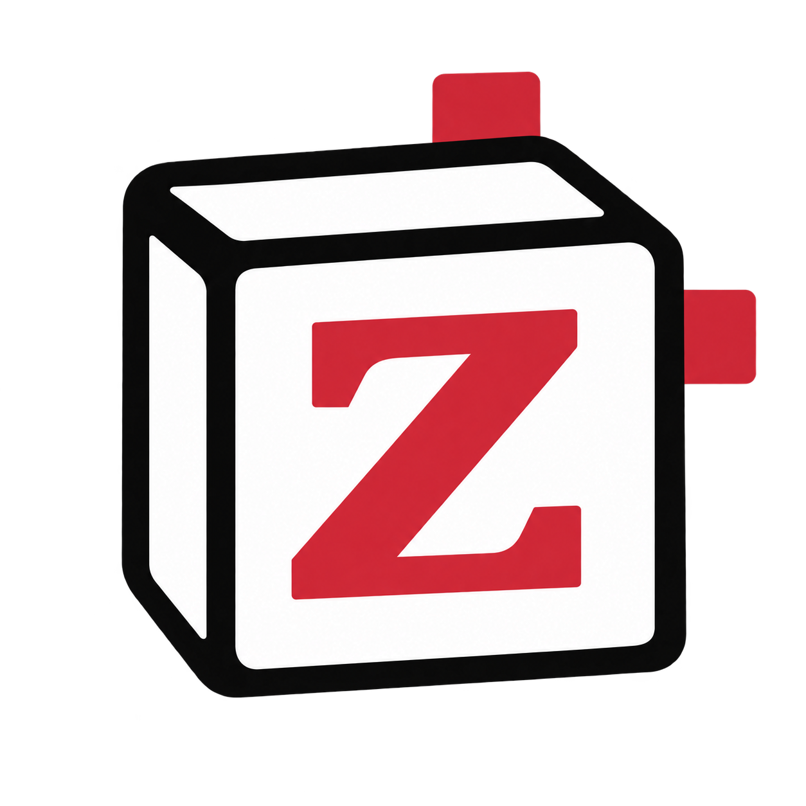

<p align="center">
  
</p>
<h1 align="center">Zotero2Notion</h1>
<p align="center">Collect papers in Zotero. Organize your learning in Notion.</p>
<p align="center">
  <a href="https://github.com/legojeon/Zotero2Notion/releases/latest">Download</a> ·
  <a href="https://sleepy-hamster-e60.notion.site/Zsotero2Notion-Journal-DB-400cf80747f2804b99e3db09641b7368">Notion template</a> ·
  <a href="docs/configuration.md">User guide</a>
</p>
<p align="center">
  <a href="https://github.com/legojeon/Zotero2Notion/releases/latest"></a>
  
  <a href="LICENSE"></a>
</p>

Add a paper to Zotero and get a Notion database entry with its metadata and a customizable space to study and organize what you learn. Later metadata updates preserve the notes you write in Notion.

- **Automatic sync:** existing and newly added items in **My Library**.
- **Your own templates:** edit Markdown in Zotero settings, with automatic saving.
- **Flexible layouts:** choose a default template or apply different ones by collection or tag.
- **Direct connection:** use your own Notion personal access token (PAT). No hosted authentication service or separate sync app.

## Get started

Requires **Zotero 10.0.x** and a Notion account that can create a PAT with the **Notion API** capability.

### 1. Install

Download the `.xpi` from the [latest release](https://github.com/legojeon/Zotero2Notion/releases/latest). In Zotero, open **Tools → Plugins → gear menu → Install Plugin From File…** and select it.

Open **Zotero Settings → Zotero2Notion**.

### 2. Connect to Notion

Click **Get token** to open the [Notion token page](https://www.notion.so/developers/tokens). Create a personal access token for your workspace with the **Notion API** capability, paste it into **Personal access token**, then click **Connect**.

The token uses your permissions in that workspace. See [Notion’s PAT guide](https://developers.notion.com/guides/get-started/personal-access-tokens) if token creation is unavailable.

### 3. Choose a database

| Start with | What to do |
|---|---|
| **A blank database** | Click **New**. The plugin creates a private top-level `Zotero2Notion` page with a `JournalDB` database and selects it. |
| **The example template** | [Duplicate the public template](https://sleepy-hamster-e60.notion.site/Zsotero2Notion-Journal-DB-400cf80747f2804b99e3db09641b7368) into your workspace. Then click **Refresh**, select the copied database, and click **Use**. |
| **Your existing database** | Click **Refresh**, choose the database, and click **Use**. Review **Check properties** and add missing properties when prompted. |

**Sync starts automatically when the database properties are ready, including all existing regular items in My Library.** Keep Zotero open for subsequent additions and edits to sync. If another Zotero-to-Notion automation is running, stop it before switching to this plugin.

## Make the page your own

Two English templates are included as **examples to get you started**:

| Example template | Structure | Completed example |
|---|---|---|
| **Paper review** | Problem → Prior work → Proposal → Evidence → Limitations → Questions → Takeaways | [Deep Residual Learning for Image Recognition](examples/resnet-paper-review.md) |
| **Section summary** | Abstract → Introduction → Related work → Method → Experiments → Results → Discussion → Conclusion | [Attention Is All You Need](examples/attention-is-all-you-need.md) |

The [public Notion template](https://sleepy-hamster-e60.notion.site/Zsotero2Notion-Journal-DB-400cf80747f2804b99e3db09641b7368) contains both completed examples with architecture figures. **New** creates an empty database with the required properties; duplicating the public template also brings its views and example pages.

Use any structure that helps you learn: rename headings, add or remove sections, or start with a blank template. In **Templates**, edit, duplicate, or create your own outline. Changes save automatically. Use **Preview** to inspect substituted Markdown or **Open folder** to edit the `.md` files in your own editor.

```markdown
# [title]
[authors] · [year]

[paper_link] · [zotero_link]

## Main idea

## Evidence

## My notes
```

Variables also accept property names such as `[Abstract]`, `[Full Citation]`, and `[Project]`. Under **Template rules**, select a default or add collection/tag rules. The first matching rule wins.

Templates populate the page once. Editing a template applies to future page creation; it does not rewrite existing notes. **The plugin creates outlines, not AI-generated paper summaries.**

## What syncs

| Data | Behavior |
|---|---|
| Title, authors, editors, abstract, venue, dates, citations, links, and other bibliographic fields | Sent from Zotero to mapped Notion properties |
| Tags and collections | Kept in sync, including removals |
| Reading status and page body | Preserved after creation |
| Project | Uses the collection name when the item belongs to exactly one collection; preserves a manually changed value |
| Local attachment paths | Sent as text when `File Path` is mapped; files themselves are not uploaded |

Sync is one-way: **Zotero → Notion**. Group libraries, trash, standalone notes, PDFs, and annotations are not synced. The plugin does not delete Notion pages when Zotero items are removed.

See the [user guide](docs/configuration.md) for all 27 default properties, matching rules, and recovery controls.

## Updates and troubleshooting

Install the latest XPI over the existing plugin to update. Releases from **0.1.10** also provide a GitHub-hosted update manifest for Zotero’s plugin updater.

- **Database missing?** Confirm the PAT belongs to the correct workspace and click **Refresh**.
- **Sync stopped?** Check property mapping, then open **Advanced → Status and recovery**.
- **Token no longer valid?** Disconnect, create a new PAT, reconnect, and select the database again.
- **A creation request timed out?** Use **Check incomplete** and inspect Notion before retrying, to avoid duplicates.

[Report an issue](https://github.com/legojeon/Zotero2Notion/issues) with your Zotero version and the error message. Leave out tokens and private library information.

## Roadmap

- [x] Automatic metadata sync and customizable Markdown templates
- [x] Publish an update feed for Zotero’s plugin updater
- [ ] Verify automatic upgrades between releases on macOS and Windows
- [ ] Discuss tag sync policy: overwriting tags from Zotero and preserving tags added in Notion
- [ ] Sync Zotero notes and PDF annotations
- [ ] Include images and attachments in synced notes
- [ ] Import and export custom templates from settings

Planned features may evolve based on feedback and testing.

## Development

```sh
npm ci
npm run check
```

Requires Node.js 22+ and `zip`. The plugin has no external JavaScript runtime dependencies. Use a separate Zotero profile for development.

[Development and release guide](docs/development.md) · [Verification](docs/verification.md) · [Privacy](PRIVACY.md)

## License and acknowledgments

[MIT](LICENSE). Third-party paper figures retain their original rights; see [THIRD_PARTY.md](THIRD_PARTY.md).

Inspired by [Notero](https://github.com/dvanoni/notero), [zotero2notion](https://github.com/nsalminen/zotero2notion), and [ZoteroToNotion](https://github.com/nanbhas/ZoteroToNotion). Zotero2Notion is an independent plugin and is not affiliated with Zotero or Notion.
