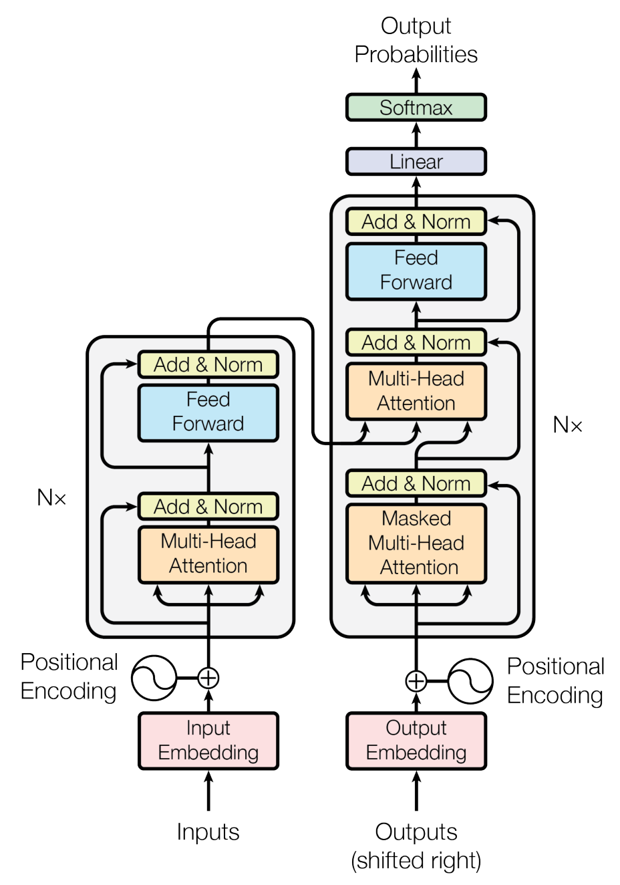

[Paper](https://papers.neurips.cc/paper/7181-attention-isall-you-need.pdf) · Vaswani et al. · NeurIPS 2017

**Section summary**

A worked example of following a paper's own section order. Section and table numbers refer to the linked conference paper.

## Abstract

The Transformer replaces recurrent and convolutional sequence processing with attention, improving translation quality and training parallelism.

## 1. Introduction

Recurrent computation limits parallel training; the proposed architecture removes that sequential dependency.

## 2. Background

Self-attention connects positions directly; convolutional alternatives require multiple layers for distant interactions.

## 3. Model Architecture

Six encoder and decoder layers combine attention, feed-forward networks, residual connections, and normalization. Positional encodings supply order; decoder masking blocks future tokens.

*Figure 1. Source: Vaswani et al., Attention Is All You Need (2017), [p. 3](https://papers.neurips.cc/paper/7181-attention-isall-you-need.pdf#page=3).*

**Scaled dot-product attention — §3.2.1**

$$
\operatorname{Attention}(Q,K,V)=\operatorname{softmax}\left(\frac{QK^{T}}{\sqrt{d_k}}\right)V
$$

Base configuration: eight heads, $`d_{model}=512`$, $`d_{ff}=2048`$. Different heads use learned projections.

## 4. Why Self-Attention

Attention shortens dependency paths, but full attention has quadratic sequence-length complexity.

## 5. Training

WMT 2014 translation; eight P100 GPUs; Adam with warmup, dropout, and label smoothing. Base training: 12 hours; big: 3.5 days.

## 6. Results

**Translation — [Table 2](https://papers.neurips.cc/paper/7181-attention-isall-you-need.pdf#page=8). BLEU; higher is better.**

| Model | English–German | English–French |
|---|---|---|
| ConvS2S | 25.16 | 40.46 |
| Transformer base | 27.3 | 38.1 |
| Transformer big | 28.4 | 41.0 |

The base model trails ConvS2S on English–French. [Table 3](https://papers.neurips.cc/paper/7181-attention-isall-you-need.pdf#page=9) tests architectural variations on a different split: newstest2013. One head underperforms; learned positions perform similarly to sinusoids.

## 7. Conclusion

Attention supports effective translation without recurrence. Restricted attention and other modalities remain proposed extensions.

## Reader's Questions

These are example questions for further investigation, not claims established by the paper.

- Which comparison would isolate architecture from training budget?
- What measurements would separate training throughput from decoding latency?
- How would I test whether an attention visualization explains a prediction?

## Personal Takeaway

*Example reader note:* When comparing models, keep the model size, dataset split, metric, and evaluation procedure beside the result. I would start a reproduction checklist from the base configuration.
