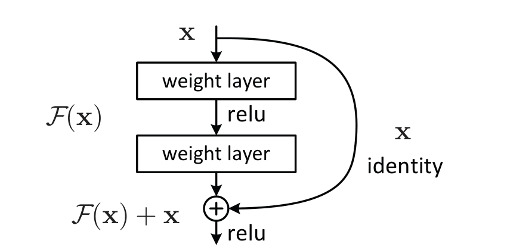
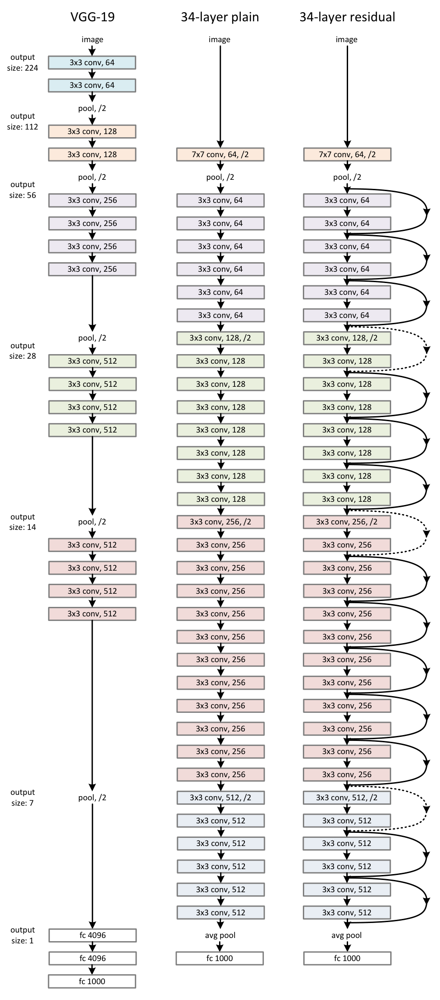

[Paper](https://arxiv.org/pdf/1512.03385) · He et al. · CVPR 2016

**Paper review**

A worked example of the Problem → Prior Work → Proposal → Evidence frame. Citations refer to arXiv:1512.03385v1, the authors' preprint of the CVPR paper.

> **One-liner** — Residual shortcuts make increased depth easier to optimize.

## Problem · §1

**What needs to be solved?**

Deeper plain networks can have higher training error.

**Why does it matter?**

Additional capacity does not automatically produce a better solution.

## Prior Work and Limitations · §§1–2

**What approaches already existed?**

Initialization and normalization improve convergence; highway networks introduce gated shortcuts.

**What specific limitation does this paper identify?**

Training degradation persists, motivating an ungated residual formulation.

## Proposal · §3

**Core idea, without equations**

Learn a correction to the input instead of an entirely new mapping.

**How does it work?**

$$
y=\mathcal{F}(x,\{W_i\})+x
$$

A projection matches dimensions when needed; ReLU follows addition.

*Figure 2. Source: He et al., Deep Residual Learning for Image Recognition, arXiv:1512.03385v1, [p. 2](https://arxiv.org/pdf/1512.03385v1#page=2).*

**Why should this address the limitation?**

The authors hypothesize that learning near-identity corrections is easier.

*Figure 3. VGG-19 (left), a 34-layer plain network (middle), and ResNet-34 (right). Source: He et al., Deep Residual Learning for Image Recognition, arXiv:1512.03385v1, [p. 4](https://arxiv.org/pdf/1512.03385v1#page=4).*

## Evidence · §4

**Original table** — [Table 2, p. 5](https://arxiv.org/pdf/1512.03385#page=5).

**Key comparison**

| What | Compared with | Result | Dataset and setting |
|---|---|---|---|
| ResNet-34 | Plain-34 | 25.03% vs 28.54% error | ImageNet validation; top-1; 10 crops |
| ResNet-18 | Plain-18 | 27.88% vs 27.94% error | Same evaluation |

**Are the comparisons controlled?**

Table 2 matches depth and parameter count within each pair; option A adds parameter-free shortcuts.

**Ablation: what contributes?**

Table 3 compares identity and projection shortcuts. The matched comparison above isolates adding shortcuts.

## Limitations and Open Questions

**What the paper acknowledges · §4.2, Table 6**

ResNet-1202 generalizes worse than ResNet-110 on CIFAR-10: 7.93% versus 6.43% best-run error; the authors suspect overfitting.

**What deserves scrutiny, and why?**

*Reader's interpretation:* The small 18-layer difference warrants caution about claiming uniform gains at every depth. I would request repeated runs before treating a small gap as decisive.

## What I Still Need to Understand

*Example reader questions:* What evidence would distinguish easier optimization from stronger regularization? Which measurements should be held constant when testing a new residual block?

## What I Take Away

*Example reader note:* I would inspect training and validation curves together before explaining a failed model. A proposed fix should be tested against a matched baseline, with failures reported beside improvements.
